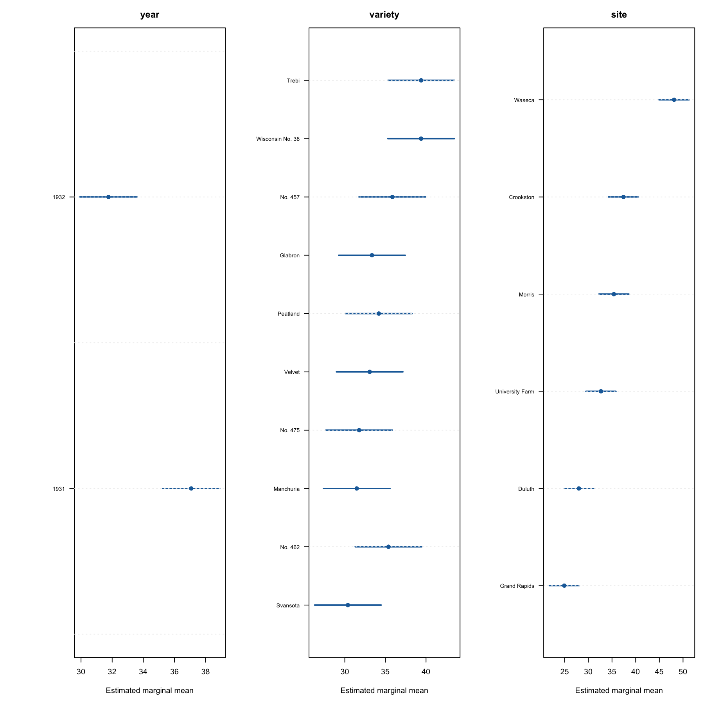

# 大麦収量の要因効果分析 / Factorial Analysis of Barley Yield

This auditable research workflow studies the public `lattice::barley` data: mean yield for 10 barley varieties at six Minnesota sites in 1931 and 1932 (120 balanced observations).

The primary, pre-specified model is:

```text
yield ~ year + variety + site + variety:site
```

The workflow emphasizes:

- design-aware fixed-effects ANOVA for year, variety, site, and the variety-by-site interaction;
- model-derived estimated marginal means and Holm-adjusted pairwise tests;
- 95% confidence intervals and standardized contrasts;
- residual, heteroskedasticity, and influence diagnostics, including HC3 sensitivity;
- AIC/AICc/BIC and leave-one-out prediction-error model comparisons;
- a documented sensitivity analysis for the historically suspected Morris year swap;
- generated figures, CSV tables, JSON summary, and a narrative report.

## 結果の概要 / Result overview



*要因モデルから得られた大麦収量の推定周辺平均と不確実性。 / Model-derived estimated marginal means for barley yield with uncertainty.*

## Reproduce

Requirements: R 4.2 or newer and the recommended `lattice` package. The exact environment used for the verified run is recorded in `renv.lock` and `results/session_info.txt`.

```bash
make all
```

Or run each stage explicitly:

```bash
Rscript scripts/prepare_data.R --output=data/barley.csv
Rscript scripts/run_analysis.R --data=data/barley.csv --results=results --figures=figures
Rscript tests/test_helpers.R
Rscript tests/test_outputs.R
```

Main outputs:

- [`REPORT.md`](REPORT.md): generated research report;
- `results/anova.csv`: factorial ANOVA and partial eta-squared;
- `results/marginal_means.csv`: model-derived marginal means;
- `results/pairwise_holm.csv`: all model contrasts and Holm-adjusted p-values;
- `results/model_comparison.csv`: model-selection sensitivity;
- `results/year_by_site_contrasts.csv`: site-specific year effects from the AICc-leading model;
- `results/diagnostics.csv` and `results/influence.csv`: assumption checks;
- `results/sensitivity_morris_swap.csv`: Morris-year correction scenario;
- `figures/`: publication-ready PNG diagnostics and summaries.

## Scope and interpretation

The data contain one value per year-by-variety-by-site cell because each value is already averaged over three randomized blocks. Block-level variability is unavailable, so the analysis cannot reconstruct the original randomized-block error structure. Inference therefore applies to this 120-row aggregated data set and its fixed-effect contrasts, not to raw plot-level observations.

See [`DATA_CARD.md`](DATA_CARD.md) for provenance, licensing, limitations, and the historical Morris-site issue.

## License

Project code and original prose are MIT licensed; see `LICENSE`. The data snapshot is generated locally from the installed `lattice` R package and is not committed. It remains subject to the upstream package and scholarly-source terms described in `DATA_CARD.md` and `THIRD_PARTY_NOTICES.md`.
